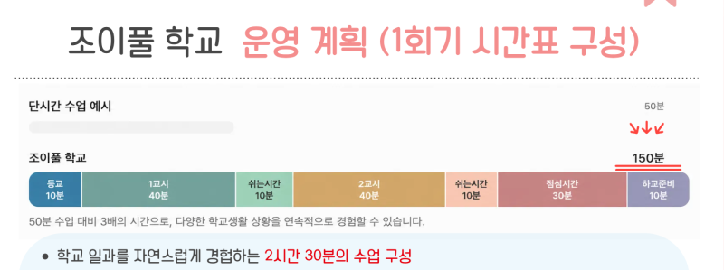

import NaverMap from '@site/src/components/NaverMap';

안녕하세요! 😊  
원주 기업도시에 위치한 <mark>언어치료 전문기관</mark>  
**조이 언어발달센터**입니다.

초등학교 입학을 앞둔 우리 아이,  
학교생활을 잘 해낼 수 있을까요?  
입학을 앞둔 부모님이라면 한 번쯤 해보셨을 고민입니다.

> "40분 동안 자리에 앉아 수업을 들을 수 있을까?"  
> "친구들과 함께하는 활동에 잘 참여할 수 있을까?"  
> "모르는 것이 생기면 선생님께 도움을 요청할 수 있을까?"  
> "급식시간이나 쉬는 시간에도 스스로 잘할 수 있을까?"

조이 언어발달센터는 아이들이 새로운 학교 환경에  
조금 더 자신 있게 적응할 수 있도록,  
예비 초등학생을 위한 학교준비 프로그램  
**'조이풀 학교'** 를 준비했습니다. 🌼

## 설명회 안내

예비 초 1(2020년생) 학부모님을 모시고  
**학교준비반 설명회**를 진행합니다.  
편하게 오셔서 프로그램을 직접 확인해 보세요.

| 구분 | 내용 |
| --- | --- |
| 📅 1차 | 2026년 11월 6일 (금) 오전 11:00 |
| 📅 2차 | 2026년 11월 7일 (토) 오후 2:00 |
| 👨‍👩‍👧 대상 | 예비 초 1 (2020년생) 학부모님 |
| 📍 장소 | 조이 언어발달센터 |

## 조이풀 학교는 어떤 프로그램인가요?

<mark>"작은 경험이 쌓여 아이들의 든든한 밑거름이 되도록."</mark>

조이풀 학교는 국어와 수학을 미리 배우는  
선행학습 프로그램이 **아닙니다.**

학교와 비슷한 환경에서 직접 경험하고,  
스스로 문제를 해결하며,  
친구들과 함께 생활하는 방법을 배우는  
**학교생활 적응 프로그램**입니다.

실제 초등학교 일과를 바탕으로  
수업시간·쉬는 시간·점심시간 등을 경험하며,  
학교생활에 필요한 다양한 기술을 연습합니다. 🙂

## 🏫 조이풀 학교에서는 무엇을 배우나요?

**01. 실제 학교처럼 경험하는 하루**  
등교부터 수업, 쉬는 시간, 점심시간, 하교 준비까지!  
학교와 유사한 일과 속에서  
시간에 맞춰 활동을 시작하고 마무리하는 연습을 합니다.

**02. 친구들과 함께 배우는 사회적 의사소통**  
차례 기다리기, 친구에게 의견 표현하기, 도움 요청하기,  
갈등 상황에서 문제 해결하기 등  
교실과 일상생활에서 필요한 의사소통 기술을 연습합니다.

## 학교준비반, 무엇이 특별한가요? 👀

**1. 150분, 실제 학교생활을 경험하는 수업**  
단순한 50분 수업을 넘어 등교부터 교과 수업,  
쉬는 시간, 점심시간, 하교 준비까지!  
실제 학교 일과를 경험하며 자연스럽게 적응력을 키웁니다.

**2. 교육과 재활의 전문성을 결합한 프로그램**  
현직 초등학교 교사의 자문을 반영하고,  
언어재활사의 전문성을 더해  
지시 이해, 자기표현, 또래 관계, 문제해결 능력을 함께 지원합니다.

**3. 언어평가와 보호자 상담을 통한 개별 맞춤 지원**  
언어평가 1회기와 해석 상담을 통해  
아이의 강점과 어려움을 살펴보고,  
학교생활에서 필요한 지원 방향을 제안합니다.

조이풀 학교는 모든 것을 완벽하게 잘하는 아이로  
만드는 수업이 아닙니다.  
새로운 환경에서도 스스로 도전하고,  
친구들과 함께 생활하며,  
어려운 상황에서 도움을 요청할 수 있는  
힘을 기르는 시간입니다.

> 선행보다 중요한 것은 **적응,**  
> 완벽함보다 중요한 것은 **경험입니다.**

우리 아이의 설레는 첫 학교생활을  
조이풀 학교가 함께 준비하겠습니다. 🌷

## 신청 및 문의

💬 설명회 신청·문의는 **네이버 톡톡 / 카카오톡 채널** 또는  
📞 전화 [033-745-1030](tel:033-745-1030) 으로 편하게 연락 주세요.  
수업 중에는 연결이 어려울 수 있으니,  
문자([010-2640-0195](sms:010-2640-0195))를 남겨주시면 연락드리겠습니다. 😊

 

---

아이들의 언어발달에 즐거움을 더하는 공간
**조이 언어발달센터**입니다.

*Let's enJOY in JOY ! 🎉✨*

📞 문의: [033-745-1030](tel:033-745-1030)  
💬 카카오채널: [joylangcenter](https://pf.kakao.com/_sxjPXn)  
⭐️ 인스타그램: [@joylangcenter](https://instagram.com/joylangcenter)  
🏠 홈페이지: [joylangcenter.com](https://joylangcenter.com)

 

<NaverMap />
