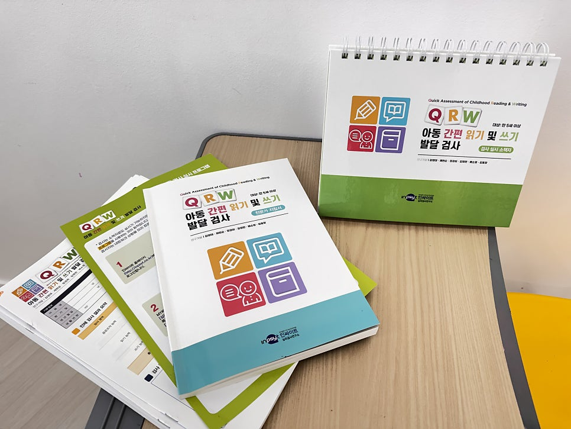
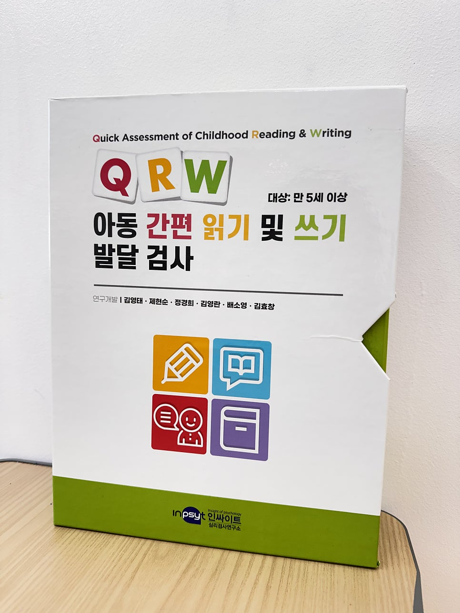
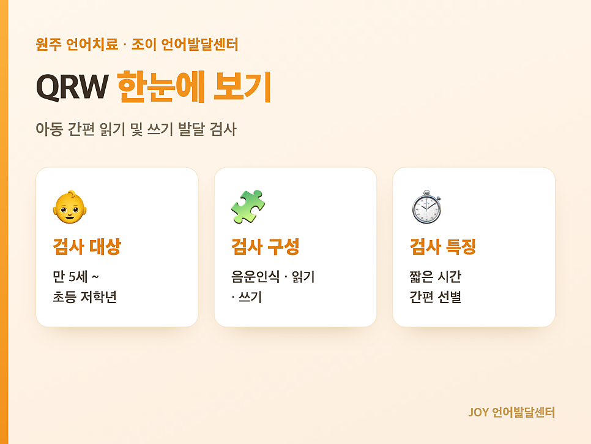
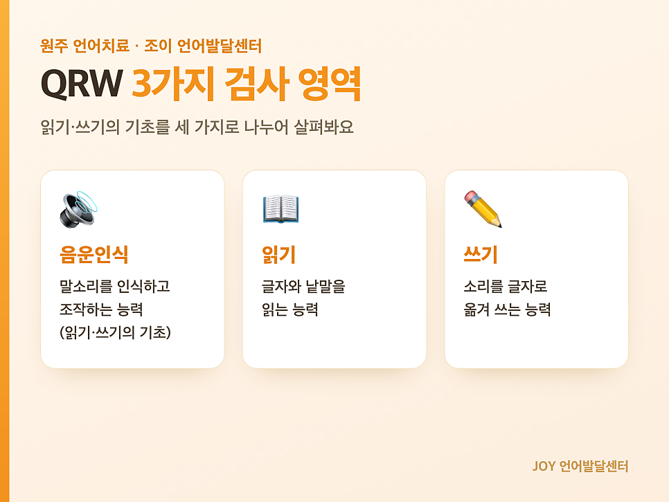
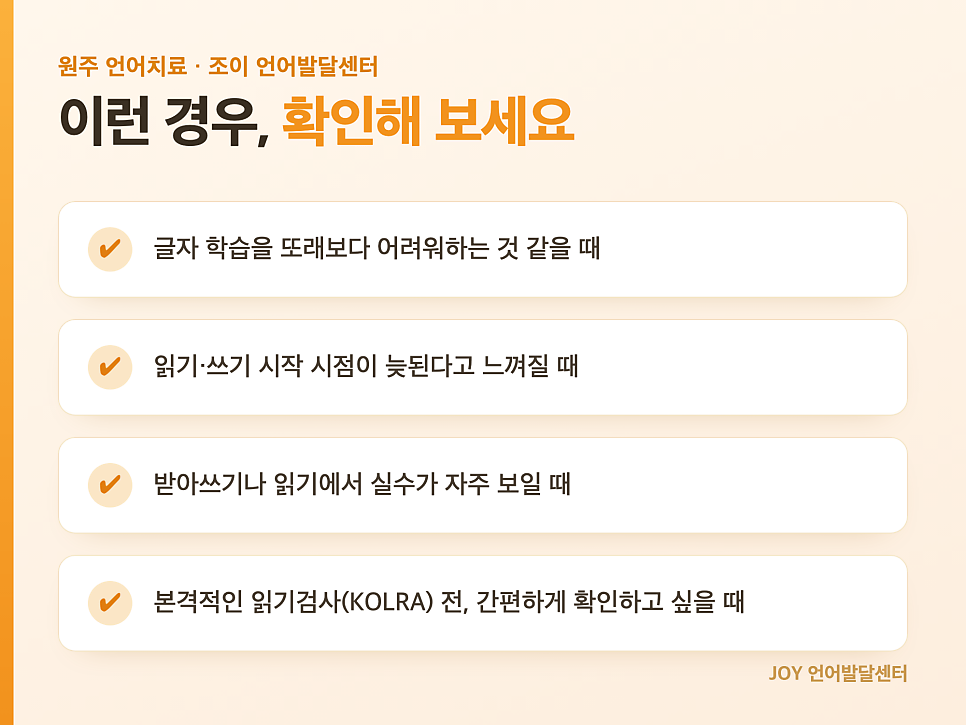

import NaverMap from '@site/src/components/NaverMap';

안녕하세요! 😊  
원주 기업도시에 위치한 <mark>언어치료 전문기관</mark>  
**조이 언어발달센터**입니다.

> "또래는 글자를 읽기 시작했는데  
> 우리 아이는 아직 어려워해요."  
> "한글을 떼고 학교에 가는 게 좋을까요?"

이런 고민으로 센터를 찾아 주시는 보호자분들이 많습니다.  
(특히 예비 초1 학부모님의 문의가 많으셨어요.)

읽기와 쓰기는 학습의 기초가 되는 능력이라,  
어려움이 의심된다면  
빠르게 현재 수준을 확인하는 것이 중요합니다.

오늘은 아이의 읽기·쓰기 발달을  
간편하게 살펴볼 수 있는 검사  
📕 **QRW** 를 소개해 드리겠습니다.

## QRW란?

**QRW** 는 아동 간편 읽기 및 쓰기 발달 검사  
(Quick Assessment of Childhood Reading and Writing)입니다.

> 연구개발: 김영태, 제현순, 정경희, 김영란, 배소영, 김효창

아동의 읽기·쓰기 능력을 간편하게 선별할 수 있는 검사로,  
비교적 짧은 시간에 효율적으로 현재 수준을 확인할 수 있어  
어려움을 조기에 발견하는 데 도움이 됩니다.

특히 국내에 출판된 읽기·쓰기 검사는  
주로 학령기 아동을 대상으로 개발되었지만,  
**QRW** 는 만 5세부터 초등학교 4학년까지 실시할 수 있어  
본격적인 학교 학습이 시작되기 전  
우리 아이의 읽기·쓰기 기초 능력을  
미리 점검해 볼 수 있다는 큰 장점이 있습니다!

## 📘 QRW의 검사 영역 3가지

QRW는 크게 세 가지 영역으로 구성됩니다.

| 검사 영역 | 내용 |
| --- | --- |
| 음운 조작 능력 | 말소리를 인식하고 조작하는 능력 (읽기·쓰기의 기초) |
| 읽기 능력 | 글자와 낱말을 읽는 능력 |
| 쓰기 능력 | 소리를 글자로 옮겨 쓰는 능력 |

✔️ **음운 조작 능력** — 음절 조작, 음절체와 종성 조작, 음소 조작 등  
✔️ **읽기 능력** — 글자소 읽기, 단어 읽기, 문장 읽기 등  
✔️ **쓰기 능력** — 단어 쓰기, 문장 쓰기 등

## 💡 이런 경우 도움이 됩니다

✔ 글자 학습을 또래보다 어려워하는 것 같을 때  
✔ 읽기·쓰기 시작 시점이 늦된다고 느껴질 때  
✔ 받아쓰기나 읽기에서 실수가 자주 보일 때

> 조이 언어발달센터에 재원 중인 예비 초1 아이들은  
> **QRW 검사가 1회 무료로 제공**됩니다!  
> (담당 선생님과 일정을 조율해 주세요.)

 

---

아이들의 언어발달에 즐거움을 더하는 공간
**조이 언어발달센터**입니다.

*Let's enJOY in JOY ! 🎉✨*

📞 문의: [033-745-1030](tel:033-745-1030)  
💬 카카오채널: [joylangcenter](https://pf.kakao.com/_sxjPXn)  
⭐️ 인스타그램: [@joylangcenter](https://instagram.com/joylangcenter)  
🏠 홈페이지: [joylangcenter.com](https://joylangcenter.com)

 

<NaverMap />
