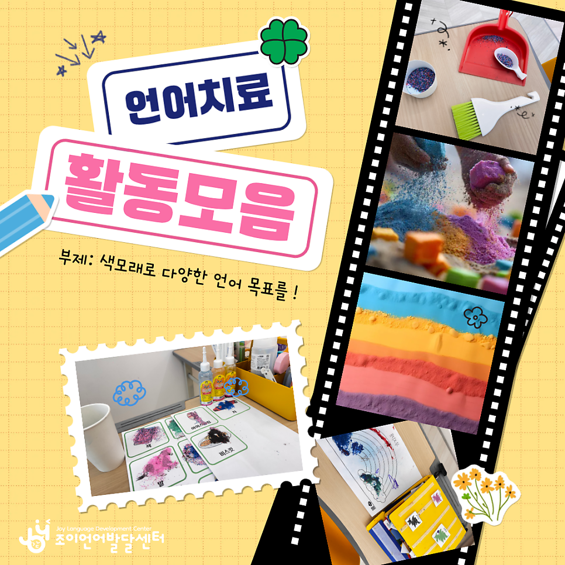
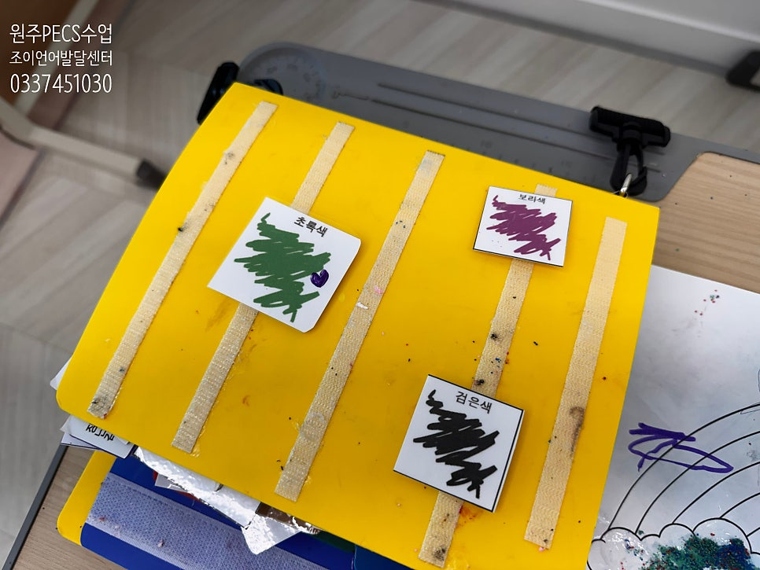
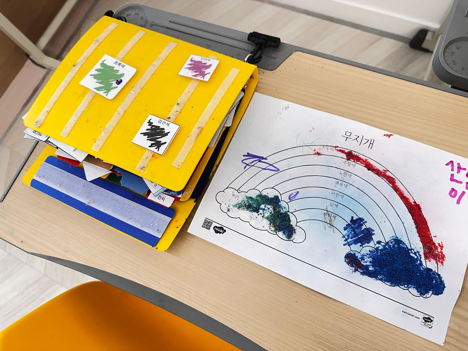
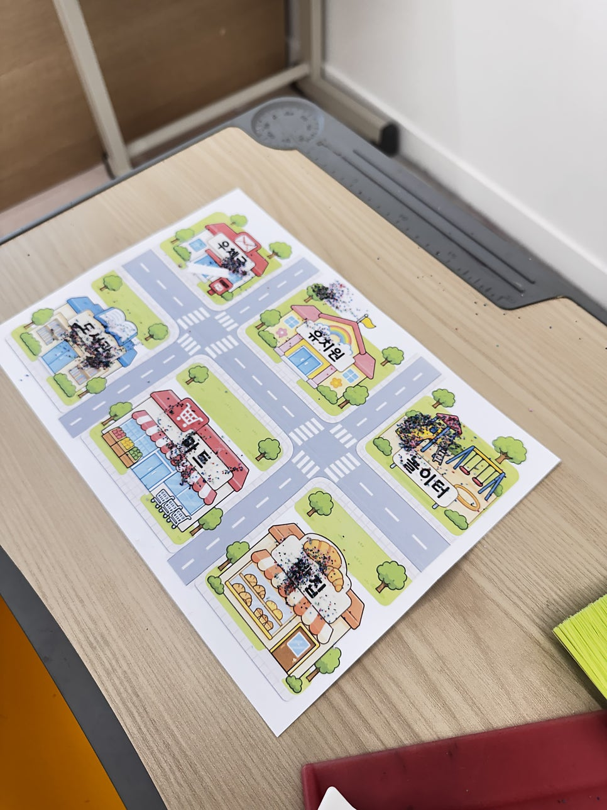
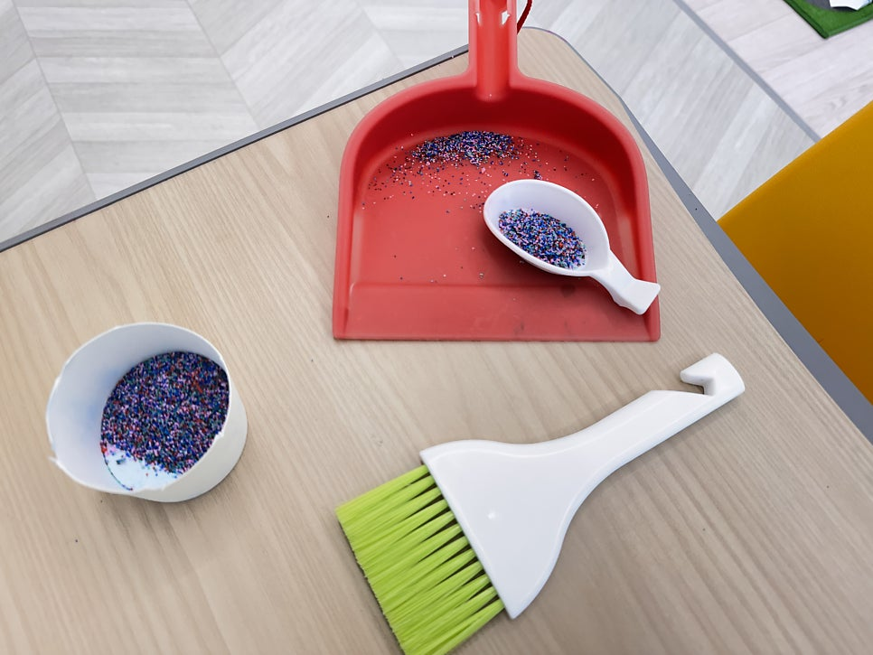

import NaverMap from '@site/src/components/NaverMap';

안녕하세요! 😊  
원주 기업도시에 위치한 <mark>언어치료 전문기관</mark>  
**조이 언어발달센터**입니다.

아이들이 좋아하는 알록달록 색모래 놀이! 🌈  
오늘 조이에서는 같은 색모래를 활용해  
아이들의 언어 수준과 개별 치료 목표에 따라  
서로 다른 언어활동을 진행했습니다.

언어치료도 즐거울 수 있어요! 😄  
단순한 놀이처럼 보이지만, 그 안에는  
아이마다 다른 언어적 목표가 담겨 있답니다.

## 1. 세 가지 색깔 변별하기 (PECS)

보라, 초록, 검정! 🎨  
세 가지 색깔 중 원하는 색을 구별하고,  
알맞은 그림을 선택하는 활동을 진행했어요.

색깔을 변별하는 능력을 바탕으로  
PECS 그림의 의미를 구별하고  
선택하는 경험을 쌓아갑니다.

## 2. 문장띠로 원하는 색깔 요구하기 (PECS)

이번에는 원하는 색모래를 그림으로 요청해 볼까요?  
<mark>'빨간색 + 색모래 + 주세요'</mark>  
PECS 문장띠를 활용하여 원하는 색깔을 선택하고,  
문장 형태로 자신의 요구를 전달하는 활동을 진행했습니다.

단순히 색깔을 아는 것에서 나아가,  
스스로 원하는 것을 표현하는  
자발적인 의사소통을 목표로 합니다.

## 3. 듣고 알맞은 장소에 모래 붙이기 (청능훈련)

이번에는 눈이 아닌 귀를 활용해 볼 차례!  
우체국, 유치원, 놀이터 등 세 가지 장소 그림을 준비하고,  
선생님이 말하는 장소를 듣고  
알맞은 그림 위에 색모래를 뿌려보았어요.

이 활동은 청각적 단어 확인  
(듣고 의미 단어 이해하기)을 향상시키기 위한 청능훈련입니다.  
같은 색모래이지만, 이번에는 색깔보다  
<mark>'장소를 듣고 이해하는 능력'</mark>에 초점을 맞추었습니다.

색모래 활동이 모두 끝난 다음에는  
빗자루와 쓰레받기를 사용해  
직접 치워보는 연습도 했답니다 :)

## 💛 다예 선생님의 한마디

> 같은 놀이라도 아이마다 배움의 목표는 다릅니다.  
> 어떤 아이에게는 그림을 구별하는 연습이,  
> 어떤 아이에게는 자신의 요구를 표현하는 경험이,  
> 또 다른 아이에게는 듣고 이해하는 훈련이 됩니다.

조이는 아이의 언어 수준과 개별 목표에 맞춰  
하나의 놀이에서도 서로 다른 배움이 일어나도록  
수업을 설계합니다.

아이들이 즐겁게 참여하는 시간 속에서  
의미 있는 언어발달이 이루어지도록,  
오늘도 고민하고 연구합니다. 🌱

 

---

아이들의 언어발달에 즐거움을 더하는 공간
**조이 언어발달센터**입니다.

*Let's enJOY in JOY ! 🎉✨*

📞 문의: [033-745-1030](tel:033-745-1030)  
💬 카카오채널: [joylangcenter](https://pf.kakao.com/_sxjPXn)  
⭐️ 인스타그램: [@joylangcenter](https://instagram.com/joylangcenter)  
🏠 홈페이지: [joylangcenter.com](https://joylangcenter.com)

 

<NaverMap />
