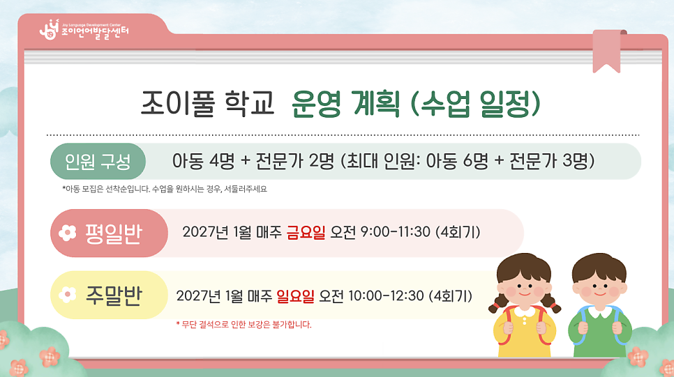

import NaverMap from '@site/src/components/NaverMap';

안녕하세요! 😊  
원주 기업도시에 위치한 <mark>언어치료 전문기관</mark>  
**조이 언어발달센터**입니다.

조이 언어발달센터에서는 2027년 1월 겨울방학 프로그램으로  
2027학년도 예비 초1 학생들을 위한  
**'조이풀 학교'** - 학교적응 수업을 오픈할 예정입니다! 🌼

1차 설명회는 11월 중 진행하였으며,  
많은 요청으로 인하여 **12월 중 2차 설명회**를 오픈합니다. 🙂

## 조이풀 학교 2차 설명회

| 구분 | 내용 |
| --- | --- |
| 📅 일시 | 2026년 12월 11일 (금) 오전 11:00 |
| 📍 장소 | 조이 언어발달센터 |

## 조이풀 학교 프로그램 일정은?

2027년 1월, **평일반(금요일) / 주말반(일요일)** 각 4회기씩 진행됩니다.  
1회기당 수업시간은 약 **2시간 30분**입니다.

| 회기 | 평일반 (금) | 주말반 (일) |
| --- | --- | --- |
| 1회기 | 1/8 (금) 9:00~11:30 | 1/10 (일) 10:00~12:30 |
| 2회기 | 1/15 (금) 9:00~11:30 | 1/17 (일) 10:00~12:30 |
| 3회기 | 1/22 (금) 9:00~11:30 | 1/24 (일) 10:00~12:30 |
| 4회기 | 1/29 (금) 9:00~11:30 | 1/31 (일) 10:00~12:30 |

\* 신청 인원이 2명 미만이면 수업은 진행되지 않습니다.

설명회와 프로그램에 관한 자세한 내용은 아래 글을 참고해 주세요!

> [우리 아이의 첫 학교생활, 조이풀 학교 설명회에 초대합니다 🎒](/blog/joy-notice-20261029)

궁금하신 사항은 [033-745-1030](tel:033-745-1030) 으로 연락 주세요. 😊

 

---

아이들의 언어발달에 즐거움을 더하는 공간  
**조이 언어발달센터**입니다.

*Let's enJOY in JOY ! 🎉✨*

📞 문의: [033-745-1030](tel:033-745-1030)  
💬 카카오채널: [joylangcenter](https://pf.kakao.com/_sxjPXn)  
⭐️ 인스타그램: [@joylangcenter](https://instagram.com/joylangcenter)  
🏠 홈페이지: [joylangcenter.com](https://joylangcenter.com)

 

<NaverMap />
