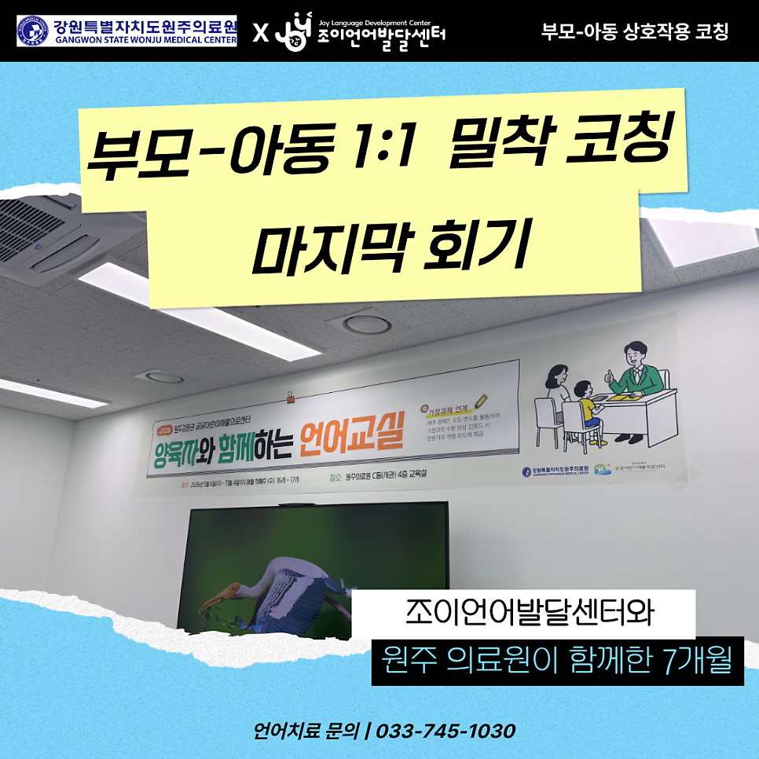
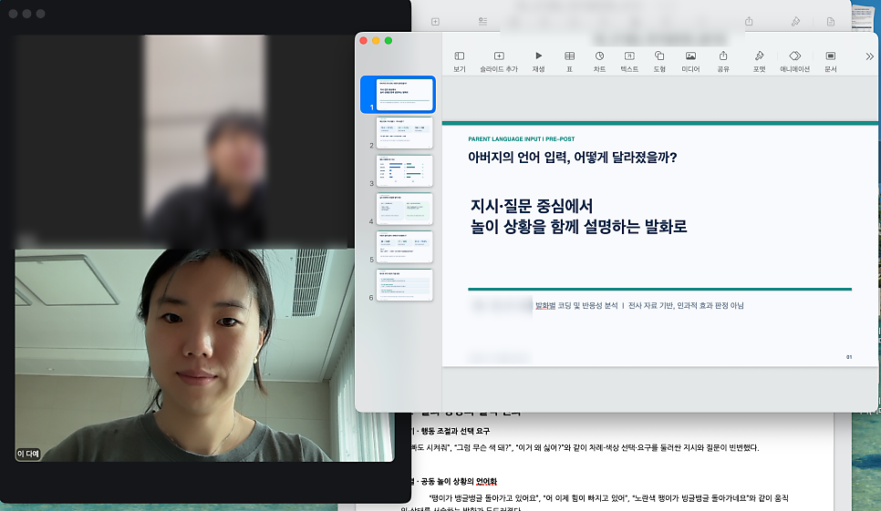
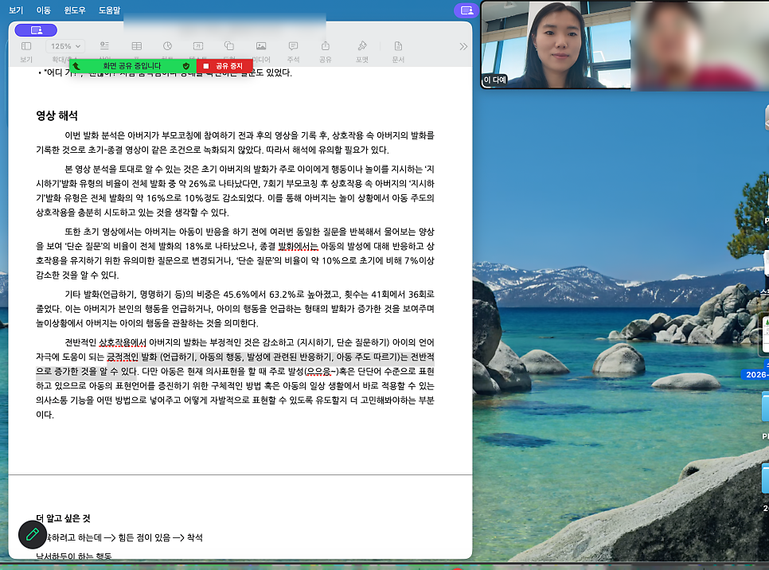
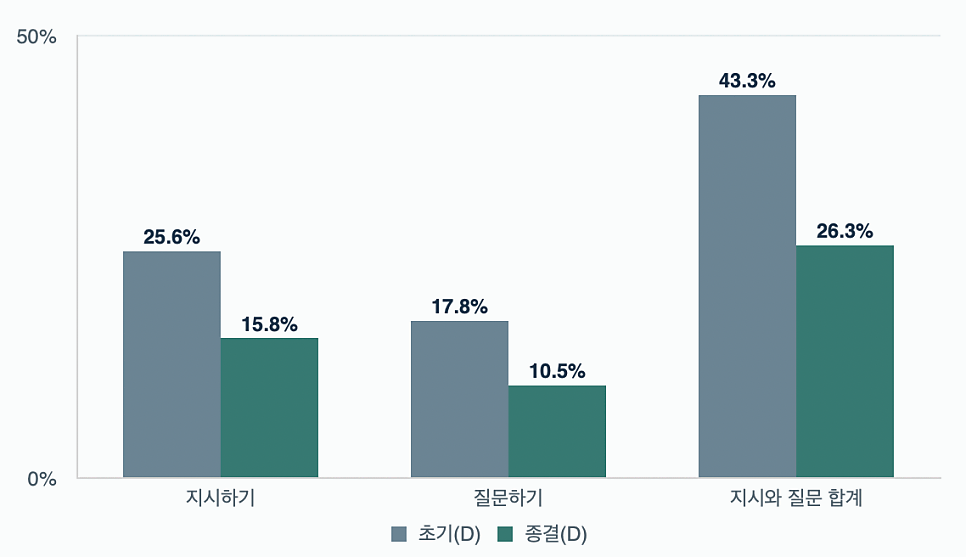
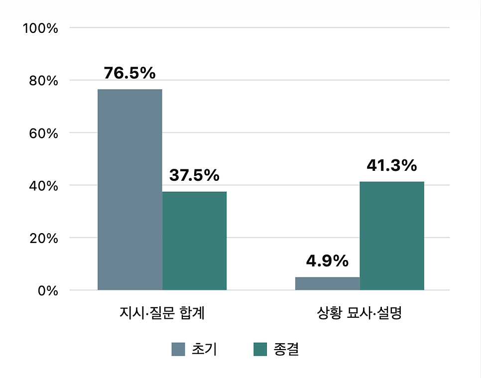
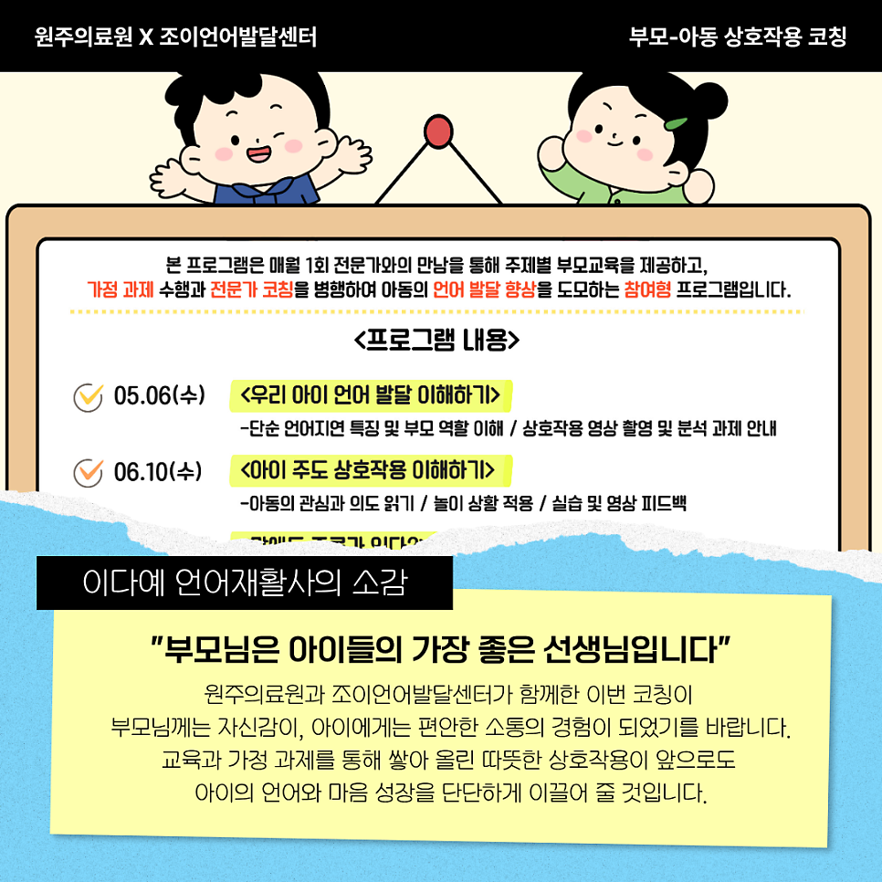

import NaverMap from '@site/src/components/NaverMap';

안녕하세요! 😊  
원주 기업도시에 위치한 <mark>언어치료 전문기관</mark>  
**조이 언어발달센터**입니다.

2026년 5월부터 11월까지 원주의료원과 함께한  
<mark>'양육자와 함께하는 언어교실'</mark>을 마무리했습니다.

마지막 시간에는 프로그램을 시작할 때 찍은 영상과  
종결 영상을 함께 보며, 아이와 대화하는  
부모님의 말과 반응이 어떻게 달라졌는지 살펴보았습니다.

## 원주의료원 부모 교실은 이렇게 진행됐어요

> **월 1회 대면 교육 → 가정 영상 제출 → 1:1 비대면 코칭**

<mark>"대면 언어교실에서 배우고, 집에서 해보고, 영상으로 돌아봤어요."</mark>

**1. 월 1회 대면 언어교실**

일상에서 아이에게 어떤 말을 들려주면 좋을지,  
아이가 말이나 몸짓으로 표현했을 때 어떻게 반응하면 좋을지  
**'상호작용을 통한 언어자극'** 을 중점적으로 배웠습니다.

아이가 관심을 보이는 것에 말을 붙여 주고,  
아이가 반응할 시간을 기다리며,  
주고받는 대화를 이어가는 방법도 함께 살펴보았어요.

**2. 월 2회 비디오 영상 제출**

이후 가정에서는 배운 방법을 아이와의 일상에 적용해 보고,  
상호작용 장면을 10~20분 정도 촬영해 주셨습니다.  
저는 영상을 보며 부모님이 어떤 상황에서 어떤 말을 건넸는지,  
아이의 표현에 어떻게 반응했는지 살펴보았습니다.

**3. 1:1 비대면 코칭**

1:1 비대면 코칭(약 40~50분) 동안  
부모님이 촬영해 주신 영상 속 실제 장면을 함께 보며,  
이미 잘하고 계신 부분과 다음에 시도해 볼 방법을  
구체적으로 이야기 나눴습니다.

*1:1 ZOOM을 통한 비대면 미팅*

## 처음과 마지막, 부모님들은 어떤 변화가 있었을까요?

마지막 시간에는 부모님이 아이에게 들려준 말의 양과 내용,  
그리고 대화가 이어지는 방식을 함께 살펴보았습니다.

**김OO 아동 아버님 발화 양상 변화**

| 김OO 가족 | 처음 영상 | 마지막 영상 |
| --- | --- | --- |
| 지시하기 | 25.5% | → 15.8% |
| 질문하기 | 17.8% | → 10.5% |

**[해석]**

▶ 어른 주도에서 아이 주도를 따라가는 형식의 상호작용으로  
긍정적인 변화가 있었어요. (<mark>"이거 해봐~"</mark> 사라짐)  
▶ 언어 "교육"을 목표로 한 <mark>"이거 뭐야?"</mark>, <mark>"이거 무슨 색이야?"</mark> 같은  
확인 질문이 확연히 줄었습니다.

---

**엄OO 아동 아버님 발화 양상 변화**

| 엄OO 가족 | 처음 영상 | 마지막 영상 |
| --- | --- | --- |
| 지시/질문 | 76.5% | → 37.5% |
| 언급/평행발화 | 4.9% | → 41.3% |

**[해석]**

▶ <mark>"이거 뭐야?"</mark>, <mark>"이거 무슨 색이야?"</mark> 같은  
단순한 질문이 현저히 줄었습니다.  
▶ 아이를 관찰하고 아이의 행동을 언급하는 묘사 언어가 늘었어요.  
(예: <mark>"팽이가 빙글뱅글 돌았네~"</mark>)  
▶ 아이와 부모가 차례를 주고받으며 구어 놀이를 하는  
상호작용 방법이 늘었습니다.

## 💛 마무리하며

> 5월부터 11월까지 집에서 하나씩 실천하고,  
> 아이와의 일상을 영상으로 담아 나누어 주신  
> 양육자분들께 감사드립니다. 😊

언어교실에서 연습한 방법들이 앞으로도  
놀이하고, 밥을 먹고, 함께 길을 걷는 평범한 순간에  
아이와 상호작용하며 질적으로 높은 언어자극을  
제공하는 데 도움이 되기를 바랍니다!

**2027년에도 강의가 개설될 예정입니다.**  
많은 관심 부탁드립니다!! 🙌

 

---

아이들의 언어발달에 즐거움을 더하는 공간  
**조이 언어발달센터**입니다.

*Let's enJOY in JOY ! 🎉✨*

📞 문의: [033-745-1030](tel:033-745-1030)  
💬 카카오채널: [joylangcenter](https://pf.kakao.com/_sxjPXn)  
⭐️ 인스타그램: [@joylangcenter](https://instagram.com/joylangcenter)  
🏠 홈페이지: [joylangcenter.com](https://joylangcenter.com)

 

<NaverMap />
